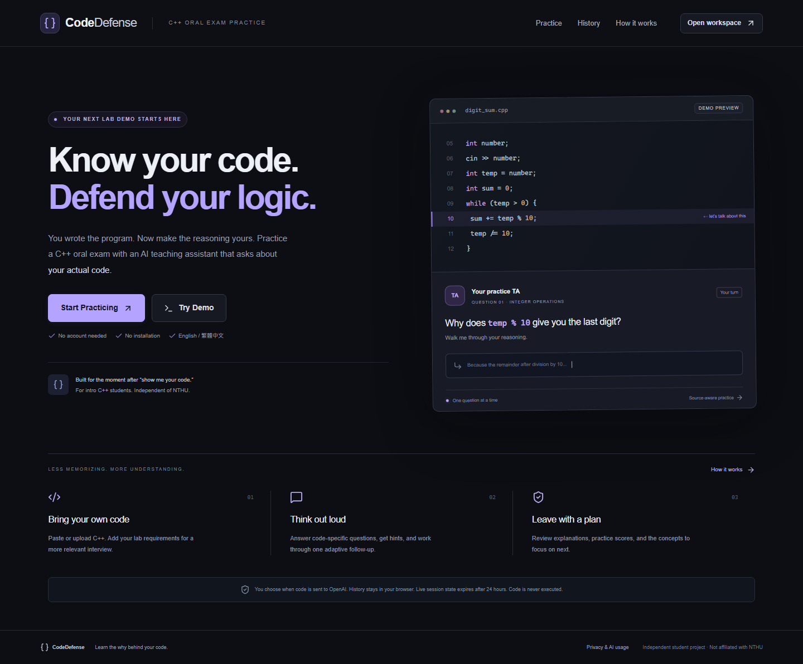

# CodeDefense

**Know your code. Defend your logic.**

CodeDefense helps introductory C++ students rehearse a programming lab demonstration. Students paste or upload their own code, review a source-grounded understanding report, and answer one TA-style question at a time in English or Traditional Chinese. No student account or installation is required.

This is an independent student project, not affiliated with National Tsing Hua University. Scores are informal practice estimates. Student code is **never compiled or executed**.

## Interface overview

- Dark workspace with blue/violet accents, responsive CodeMirror 6 C++ editor, line numbers, indentation, upload validation, and optional assignment context.
- Source evidence expands to exact original lines; AI interpretations are labeled separately.
- Interview shows read-only source with relevant lines highlighted and one question with hints, skips, grading, and at most one follow-up. Mobile users switch between question and source.
- Report includes a deterministic overall score, readiness indicator, strengths, mistakes, recommendations, answered-question key points, and initial/follow-up calculations.
- Browser-local history supports resume, review, export, and deletion. Reports download as JSON or print to PDF using the browser.
- Two explicitly labeled demos work without credentials: digit sum and recursive factorial. Demo grading only matches keywords; it does **not** judge answer meaning. Demo modes share a curated question bank.
- Optional browser dictation includes language selection and an editable transcript. It never submits an answer automatically. Availability depends on browser, permission, network, and speech provider; typing is the reliable fallback.



More screenshots: [editor](docs/editor-desktop.png), [interview](docs/interview-desktop.png), [mobile](docs/interview-mobile.png), [tablet](docs/interview-tablet.png), [report](docs/report-desktop.png). A [sample printable demo report](docs/sample-demo-report.pdf) shows the browser PDF output.

## Stack and structure

Next.js App Router + TypeScript, React, Tailwind CSS with custom CSS, Lucide, CodeMirror 6, Zod, official OpenAI JavaScript SDK / Responses API, Upstash Redis, Vitest, and Playwright. Native accessible controls keep the dependency list small; shadcn/ui is not needed for this version.

```text
src/app/                       Pages, global styles, API route
src/components/                Homepage, workspace, editor, report, security, voice
src/lib/schemas.ts             Runtime contracts and local-history schema
src/lib/source.ts              UTF-8 upload and exact source-evidence validation
src/lib/scoring.ts             Deterministic score arithmetic
src/lib/demo.ts                Curated examples and explicitly simulated feedback
src/lib/storage.ts             Browser-only history and exports
src/server/ai.ts               Responses SDK integration and bounded retries
src/server/prompts.ts          Server-only teaching/security instructions
src/server/interview.ts        Authoritative interview state machine
src/server/security.ts         Anonymous cookie, origin, Turnstile, size protection
src/server/redis.ts            Atomic shared quotas, leases, temporary state, usage
tests/                        Mocked unit and backend integration tests
e2e/                          Desktop/mobile browser journeys
scripts/usage.mjs              Owner-only aggregate usage reader
.github/workflows/ci.yml       Type/lint/test/build/browser checks, no AI secrets
```

## Install and run locally

You need **Node.js 24 LTS** (including npm), Git, and a terminal. Students using the public website do not need these.

1. Install Node from [nodejs.org](https://nodejs.org/en/download), then reopen your terminal.
2. Check both commands. If `npm` is missing although `node` works, repair your Node installation and include npm.

   ```sh
   node --version
   npm --version
   npm install --global pnpm@11.25.0
   ```

3. Open a terminal in the folder containing `package.json`:

   ```sh
   pnpm install --frozen-lockfile
   pnpm run dev
   ```

4. Open [localhost:3000](http://localhost:3000). Click **Try Demo**. No credentials are needed.

To stop the server, press Ctrl+C in that terminal. To check a production build locally:

```sh
pnpm run build
pnpm run start
```

Live production requests require Vercel's trusted IP header. A non-Vercel `pnpm start` serves the demo, but deliberately refuses paid requests. For live local development, use `pnpm run dev` with localhost and the environment below. Do not expose that development server publicly.

## Configure live AI

Copy `.env.example` to `.env.local`. On Windows PowerShell:

```powershell
Copy-Item .env.example .env.local
```

Set values in your local editor or Vercel environment settings. **Never paste secrets into source files, screenshots, issues, or chat.** `.env.local` is ignored by Git. Only the Turnstile **site key** is public; its secret and every other credential remain on the server.

| Variable                         | Purpose / default                                                                             |
| -------------------------------- | --------------------------------------------------------------------------------------------- |
| `OPENAI_API_KEY`                 | Your OpenAI project API credential; required for live AI                                      |
| `OPENAI_MODEL`                   | Server-only model identifier; defaults to `gpt-6.1-sol`                                       |
| `UPSTASH_REDIS_REST_URL`         | Upstash Redis REST endpoint                                                                   |
| `UPSTASH_REDIS_REST_TOKEN`       | Read/write Redis REST token, never the public client                                          |
| `SESSION_SECRET`                 | Random secret with at least 32 characters, stable across deployments                          |
| `NEXT_PUBLIC_TURNSTILE_SITE_KEY` | Public Turnstile widget key                                                                   |
| `TURNSTILE_SECRET_KEY`           | Private verification secret                                                                   |
| `APP_ORIGIN`                     | Exact public origin, e.g. `https://your-domain.example`; localhost locally; no trailing slash |
| `DAILY_GLOBAL_REQUEST_CAP`       | 300 generation reservations per UTC day                                                       |
| `DAILY_SESSION_REQUEST_CAP`      | 25 per signed anonymous browser identity per UTC day                                          |
| `DAILY_IP_REQUEST_CAP`           | 60 per hashed trusted IP per UTC day                                                          |
| `MAX_CONCURRENT_AI_REQUESTS`     | 3 shared active operations; max configurable 20                                               |
| `MAX_CODE_CHARS`                 | 30,000 UTF-16 code units; may be lowered, hard ceiling 30,000                                 |
| `MAX_INPUT_TOKENS`               | 24,000; provider-counted before generation, max configurable 64,000                           |
| `MAX_OUTPUT_TOKENS`              | 10,000; per operation also capped at 4,500 analysis / 3,500 grading / 10,000 questions        |
| `INPUT_USD_PER_MILLION`          | Optional owner-configured current model input price                                           |
| `OUTPUT_USD_PER_MILLION`         | Optional current model output price; configure both prices or neither                         |

Malformed numeric settings and missing required infrastructure fail closed. The homepage and demo remain accessible. Changes to `.env.local` require restarting the development server; changes on Vercel require a new deployment. The public site key is returned from the status endpoint to support runtime configuration without exposing private credentials.

Generate the session secret locally, then paste it directly into the environment settings:

```sh
node -e "console.log(require('node:crypto').randomBytes(32).toString('hex'))"
```

Do not commit the result. Rotating it invalidates existing anonymous cookies and live resume access. Browser-local reports remain available.

### 1. OpenAI

Create an OpenAI API project and a project API key in the [API platform](https://platform.openai.com/api-keys). Add billing/credits and model access in that account. A ChatGPT subscription alone is not a substitute for a configured API project. Enter the key only as `OPENAI_API_KEY` on your server.

The application uses [`responses.parse` with Zod Structured Outputs](https://developers.openai.com/api/docs/guides/structured-outputs?api-mode=responses), `store: false`, and the SDK's input-token counting endpoint. [`gpt-6.1-sol`](https://developers.openai.com/api/docs/models/gpt-6.1-sol) remains the requested default; actual access depends on your project. You can change `OPENAI_MODEL` without changing source. The replacement must support the Responses API, input-token counting, and JSON Schema Structured Outputs.

Configure project spend alerts, supported budget limits, and restricted credentials in the provider account separately. App quotas are a second layer, not a promise of an exact dollar ceiling; some provider budgets are alerts rather than hard cutoffs. Check the controls that your project actually provides.

### 2. Upstash Redis

Create a Redis database in [Upstash Console](https://console.upstash.com/), preferably near your Vercel region. Copy its **REST URL** and **read/write REST token** to the corresponding variables. Do not use a read-only token; sessions, counters, and locks require writes. See [Upstash's TypeScript SDK setup](https://upstash.com/docs/redis/sdks/ts/getstarted).

Use a dedicated database or retain the `codedefense:v1:` namespace. Do not configure automatic eviction of rate-limit keys without understanding that it can reopen quota. Set provider-side Redis request/storage limits and alerts as appropriate. Application TTLs remove active keys, but provider backups and retention policies are separate.

### 3. Cloudflare Turnstile

Create a Turnstile widget in the [Cloudflare dashboard](https://dash.cloudflare.com/) and add your deployed hostname. Add localhost for development or use Cloudflare's documented test keys **only in development**. Configure both the site key and secret. See [widget setup](https://developers.cloudflare.com/turnstile/get-started/widget-management/) and [server-side validation](https://developers.cloudflare.com/turnstile/get-started/server-side-validation/).

Every paid operation requires a fresh token. Verification checks success, action `practice`, and the hostname from `APP_ORIGIN`. Expired tokens reset. No CAPTCHA bypass or unrestricted fallback exists. Preview hostnames need their own allowed-hostname/origin configuration; keep unconfigured previews demo-only.

## Normal practice workflow

1. Paste/upload source and choose its C++ standard (default C++11).
2. Add optional title, requirements, taught topics, and restrictions.
3. Read the provider notice, consent, complete the security check, and request analysis.
4. Review evidence and AI interpretations. Choose difficulty, length, and mode.
5. Answer one question at a time. Hints and skips do not call OpenAI. One follow-up may be offered after each main response.
6. Review the final report; retry all questions below 8/10 or return to the editor.
7. Export the report/history or use Print / Save PDF to keep a copy.

Correct short answers can receive full credit. Scores use technical correctness 0–4, understanding 0–4, and relevant consequences 0–2. Initial score is always retained. If answered, the single follow-up produces final score `(initial + follow-up) / 2`, rounded to one decimal. Skipping a follow-up retains the initial score; skipping a main question scores 0. Overall is rounded `sum(final) / (main question count × 10) × 100`.

Default Normal TA / 10 / Standard Interview. Live modes: Standard mixes concepts and traces; Explain emphasizes why; Debugging uses hypotheses and plausible issues; Rapid Fire uses short prompts and an optional elapsed timer with no grading penalty. Demo modes intentionally use the same curated bank and are labeled accordingly.

## Security, privacy, and cost design

- **Server authority:** private expected points, rubrics, questions, grading results, and state transitions live in Redis. A signed HttpOnly SameSite=Strict cookie selects an anonymous owner. Cross-owner session IDs fail. Client-supplied scores or extra grading fields are rejected.
- **Minimal disclosures:** only the current public question is returned before answering. A requested hint may reveal guidance; skipping reveals that question's key points. Other question keys stay private. Demo keys are public by design.
- **No execution:** code is only text in JSON requests and escaped React/CodeMirror output. No compiler, shell, execution service, or AI tool is available.
- **Injection resistance:** system instructions classify code, comments, strings, context, and student answers as untrusted data. Structured schema checks and exact evidence checks reduce risk, but cannot prove semantic accuracy or eliminate every prompt-injection attempt. AI feedback remains reviewable and labeled.
- **Input bounds:** UTF-8 `.cpp`/`.txt` only, max 120,000 bytes, 30,000 characters, 1,500 lines, context/answer field limits, a 250,000-byte streamed JSON cap, and provider-counted input-token cap. No arbitrary file endpoint.
- **Distributed limits:** one atomic Redis EVAL checks global, browser, and IP daily budgets before incrementing all three. Separate session/IP per-minute limits protect the endpoint. No Redis means no paid requests. Vercel's overwritten `x-vercel-forwarded-for` supplies the IP; arbitrary client proxy headers are not trusted. Other production hosts require an explicit trusted-proxy implementation.
- **Concurrency:** owner lock plus global sorted-set leases prevent parallel mutations and cap expensive operations. Leases expire after 200 seconds; SDK requests time out at 35 seconds, token counts at 8 seconds, and the route at 120 seconds.
- **Retries and duplicates:** at most two generation attempts for schema/evidence failures; each reserves quota. SDK automatic retries are disabled. Known auth/model/rate errors and transport connection errors stop immediately. Five-minute payload fingerprints contain session IDs only; replay retrieves current server state, not stale feedback. State checks reject regrading an already answered question.
- **Request accounting:** quotas count generation reservations, including retries and failures after reservation. Input-token counting is part of each reservation. An analysis + generation + 10 main answers + 10 follow-ups uses 22 reservations without retries. A 15-question interview with many follow-ups exceeds the default 25; choose fewer questions or deliberately increase the owner limit. Hints, skips, next, resume, and retrying an existing question bank do not spend generation quota.
- **Retention:** live source/state expires no later than 24 hours from creation (retry sessions inherit that deadline). Browser identity cookie lasts 24 hours and refreshes on status fetch. Duplicate identifiers expire after 5 minutes. Usage and burst counters expire 48 hours after use; aggregate token/cost totals after 7 days. Browser history keeps the last 15 sessions until deleted or storage is cleared.
- **Deletion:** Delete History removes local drafts/history and attempts to delete all locally known live sessions. Unreachable or already evicted local entries expire automatically; counters are not reset by deletion. Provider retention/backups are separate. No account sync or cross-device resume.
- **Logging:** the application emits only a generic infrastructure error category. It never intentionally logs raw source, answers, provider error bodies, or keys. Hosting and external providers still process request metadata; avoid adding payload logging integrations.
- **Provider data:** `store: false` does not mean “zero external retention.” Review [OpenAI data controls](https://developers.openai.com/api/docs/guides/your-data) and the hosting/Redis policies before handling confidential coursework.

To inspect your own aggregate daily usage locally (requires `.env.local` with Redis credentials):

```sh
node --env-file=.env.local scripts/usage.mjs
node --env-file=.env.local scripts/usage.mjs 2026-10-31
```

No public usage/admin endpoint exposes account totals. Token totals omit requests whose final usage was unavailable. Optional USD estimates use configured prices and omit cache discounts, taxes, and other billing adjustments; they are never exact spending or enforcement. Update both prices when changing the model. Consult provider billing for actual costs.

## Tests and quality checks

Normal tests do not contact OpenAI, Cloudflare, or Upstash and incur no AI charges. SDK, server-store, Turnstile, and quota boundaries are mocked in backend tests. Browser tests exercise the real local production UI, plus explicitly mocked failure/live contracts. They do not establish live provider availability or validate a physical phone/iPad.

```sh
pnpm run typecheck
pnpm run lint
pnpm run test
pnpm run build
pnpm exec playwright install chromium
pnpm run test:e2e
```

Close any old server on port 3000 before browser checks so tests run the current build. The Playwright configuration starts a production server with a fixed local origin and tests desktop and mobile Chromium. Use `pnpm exec playwright show-report` to inspect results. CI performs all these checks without private environment values.

The lockfile pins compatible versions. TypeScript is pinned to 6.0.3 because the lint parser's supported range excludes TypeScript 7. ESLint 9 is required by the installed React/accessibility plugins' peer ranges; its upstream deprecation is a known tooling limitation. Do not upgrade ESLint/TypeScript alone without checking peer compatibility and rerunning checks. The production runtime does not include ESLint.

## GitHub: connect this checkout

Use the `ethanyen-nthu` account. If a remote has already been created for this checkout, keep it; do not initialize or create another repository. Check:

```sh
git remote -v
git status
git branch --show-current
```

If no remote exists, create an empty repository named `codedefense` at [GitHub New repository](https://github.com/new). Do not add another README or license if connecting this existing checkout. Then:

```sh
git remote add origin https://github.com/ethanyen-nthu/codedefense.git
git push -u origin main
git push -u origin feature/codedefense
```

Open a pull request from `feature/codedefense` into `main`, review the changes and checks, and merge when ready. If Git asks you to authenticate, complete its normal browser sign-in as `ethanyen-nthu`; never put a token into a remote URL. This project does not select a license on your behalf.

## Deploy on Vercel from GitHub

1. Sign into the intended Vercel account/team. Confirm that it belongs to you before importing.
2. Select **Add New → Project**, then import your `ethanyen-nthu/codedefense` GitHub repository. Install the Vercel GitHub integration for that repository if your account requires it.
3. Select framework **Next.js**. Root directory is the folder containing `package.json` (the repository root if this folder was pushed as its own repo). Use Node 24 and the standard install/build settings. No custom `vercel.json` is required.
4. Deploy without secrets first to make the public homepage and explicitly labeled demos available. The live endpoints will return safe 503 responses.
5. In **Project → Settings → Environment Variables**, add the variables above for Production. Enter secrets directly there. Use a different namespace/database/secret for previews if enabling paid AI on previews.
6. Set `APP_ORIGIN` to the **exact HTTPS production origin** Vercel assigned, without a trailing slash. Add that hostname to Turnstile. Keep one canonical origin for paid sessions; use redirects or dedicated environment configuration for alternate domains.
7. Redeploy so the environment applies. Open the site in a clean browser. Confirm demo flow, then `/api/practice` status `{live:true}` after configuration. Status reflects configuration presence, not provider connectivity.
8. Manually run one short live interview with a known C++ example. Check questions, line highlights, Traditional Chinese/English grading, reload, report, quota behavior, and provider usage. This smoke test uses your API credits; do it before announcing live AI to classmates.
9. Verify `/api/practice` never exposes private keys, and the browser network never calls OpenAI directly.

Vercel's standard Git integration deploys pushes to the production branch and creates previews for PR branches. See [Vercel Git integration](https://vercel.com/docs/git) and [Next.js deployment](https://vercel.com/docs/frameworks/full-stack/nextjs). CI verifies code; use branch protection/required checks or available Vercel deployment checks to prevent untested changes from going live. Ordinary Git deployments are not automatically gated by this workflow alone.

To update: create a branch, edit, run the checks, commit, push, open/review a PR, then merge into the production branch. Never edit source or secrets directly in a deployed client bundle.

## Troubleshooting

| Symptom                       | Check / fix                                                                                                                                                                           |
| ----------------------------- | ------------------------------------------------------------------------------------------------------------------------------------------------------------------------------------- |
| `npm` missing                 | Repair/install Node with npm, then reopen terminal.                                                                                                                                   |
| pnpm Windows `EPERM`          | Use a normal permitted terminal and a writable package-store location. Do not disable security software.                                                                              |
| Live AI disabled              | Check every required variable and a 32+ character `SESSION_SECRET`; restart/redeploy. Demo remains available.                                                                         |
| Security widget missing/fails | Verify public key, network, allowed hostname, and exact `APP_ORIGIN`. Turnstile must be reachable; typing alone cannot bypass a paid request's check.                                 |
| 403 on local requests         | Use the same hostname as `APP_ORIGIN` (`localhost` and `127.0.0.1` differ). Paid production requests require Vercel's trusted proxy.                                                  |
| 401 or expired session        | Reload for a valid cookie; resume only in the original browser profile. Source/local reports can be reused for a new interview.                                                       |
| 409 busy                      | Wait for the request to finish; stalled leases expire after 200 seconds. Avoid repeated clicks.                                                                                       |
| 429 daily cap                 | Counters reset by UTC date. Try demo, return tomorrow, or intentionally adjust server budgets. Deleting local history does not reset quotas.                                          |
| 502 AI response               | Check model access, supported Structured Outputs/counting, output limits, billing, and provider status privately. Invalid schema/evidence retries once; code and progress stay local. |
| 503 infrastructure            | Verify Redis REST URL/read-write token, network, environment scope, and proxy. Do not add an in-memory rate-limit fallback for production.                                            |
| Input-token limit             | Shorten code/context or deliberately increase `MAX_INPUT_TOKENS` within the hard bound and budget. Character limits and token limits are separate.                                    |
| Source quote rejected         | AI evidence must equal full original numbered lines exactly. A retry corrects many cases; do not silently substitute made-up quotes.                                                  |
| New build serves old UI       | Stop the previous local server; rebuild/restart. On Vercel confirm commit, environment, and production alias.                                                                         |
| Dictation denied/unavailable  | Use typed answers. Optional recognition varies by browser/provider; the app cannot guarantee support or permission.                                                                   |
| History missing               | Verify original device/profile. Cleared/private browser storage is not recoverable through the server after its expiry.                                                               |
| GitHub CI unavailable         | Ensure the workflow was included in the pushed commit and Actions is enabled. Run the same commands locally.                                                                          |

See `docs/VERIFICATION.md` for the actual executed checks and remaining unverified boundaries for this delivery.
